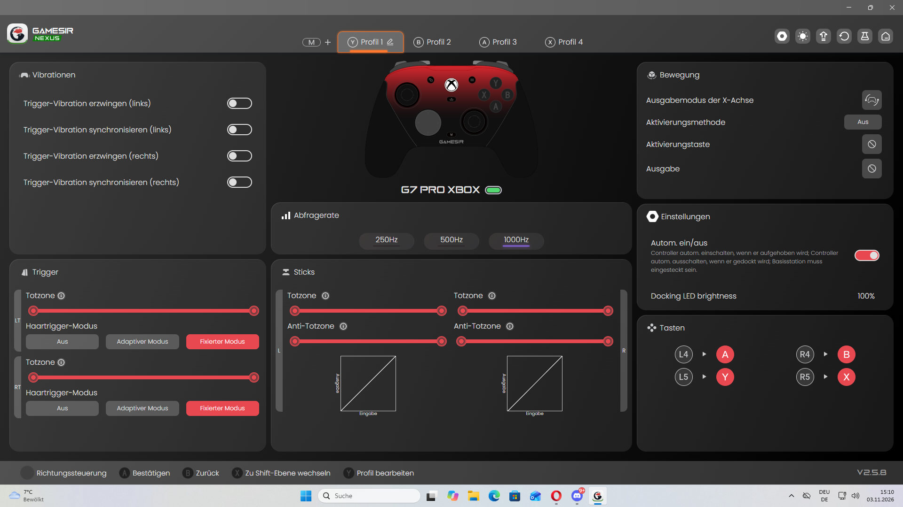
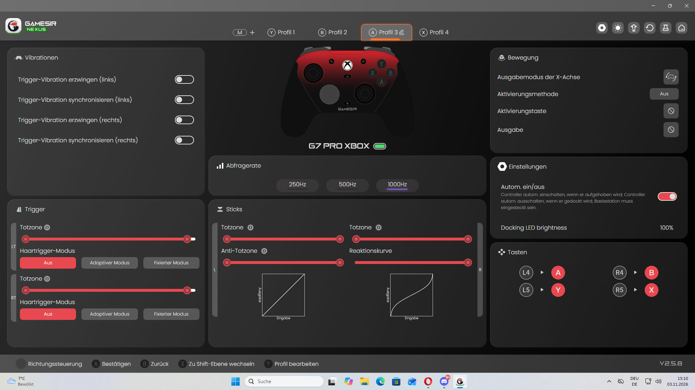
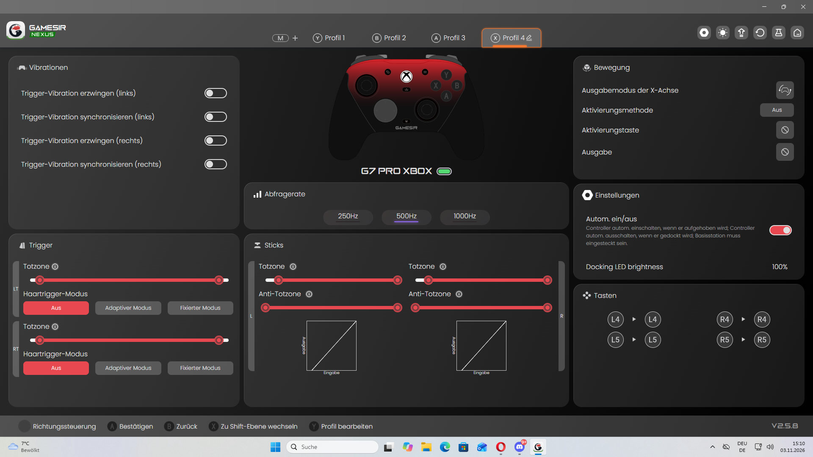

# GameSir G7 Pro: Meine Shooter-Einstellungen – Warum mich GameSir Nexus so begeistert

**Ein Controller kann gute Hardware haben. Aber erst wenn ich ihn an meinen eigenen Spielstil anpassen kann, wird er für mich richtig interessant.** Genau das ist beim GameSir G7 Pro passiert.

Ich habe den Controller auf meiner **Xbox Series S und am PC** in **Call of Duty: Warzone, Black Ops 7, Battlefield 6 und Rainbow Six Siege** ausprobiert. Schon auf der Konsole hat mich das Aim-Gefühl begeistert. Am PC fühlt es sich für mich teilweise so präzise an, dass ich scherzhaft sage: fast wie Aimbot.

Nein, der Controller zielt nicht von selbst. Aber das Zusammenspiel aus für mich angenehm leichtgängigen TMR-Sticks, meiner Reaktionskurve und den vielen Einstellungen in **GameSir Nexus** macht im Spielgefühl einen echten Unterschied.

Hier zeige ich mein persönliches Setup – **mit echten Screenshots meiner Profile**. Wer einfach nur einen Controller anschließen und spielen will, kann das tun. Wer wie ich gerne an seinen Einstellungen feilt, bekommt hier aber besonders viel zum Ausprobieren.

## Mein Herzstück: Profil 2 in GameSir Nexus

Ich habe mehrere Konfigurationen getestet. **Profil 2 ist mein Hauptprofil**, zu dem ich immer wieder zurückkomme.

- **Abfragerate:** 1000 Hz im gezeigten PC-Profil
- **Stick-Deadzone:** Wert 3 statt der vorherigen 6
- **Linker Stick:** lineare Reaktionskurve
- **Rechter Stick:** individuell angepasste S-förmige Kurve
- **LT und RT:** adaptiver Haartrigger-Modus
- **Trigger-Vibration:** in diesem Profil deaktiviert
- **Links hinten (L4):** A – Springen
- **Rechts hinten (R4):** B – Ducken und Rutschen

**Wichtig:** Die 1000-Hz-Einstellung auf meinem Screenshot ist keine Aussage darüber, dass Xbox ebenfalls mit 1000 Hz arbeitet. Auch die einzelnen Nexus-Einstellungen sind persönliche Vorlieben, keine garantierte Leistungssteigerung.

.png)

*Mein echtes Nexus-Profil 2. Keine Hersteller-Mustergrafik, sondern meine eigene Konfiguration.*

## Das eigentliche Highlight: Meine S-Kurve für den rechten Stick

Für mich wird der GameSir G7 Pro besonders spannend, wenn es um **feine Stickeingaben und die Kontrolle des Waffenrückstoßes** geht.

In Call of Duty nutze ich im Spiel die **dynamische Zielreaktionskurve**. Zusätzlich habe ich in GameSir Nexus für den rechten Stick eine eigene S-förmige Kurve eingestellt. Das ist keine Einstellung, die ich nur für eine einzelne Waffe aktiviere: **Ich spiele dauerhaft damit.**

Bei manchen Waffen reichen mir winzige Bewegungen des rechten Daumens, um den Recoil manuell auszugleichen. Manchmal fühlt es sich fast so an, als würde schon das leichte Auflegen des Daumens genügen. Sobald ich den Stick gar nicht mehr berühre, verhält sich der Rückstoß normal.

Die Kurve **erkennt keine Gegner und kompensiert keinen Recoil automatisch**. Sie beeinflusst lediglich, wie meine tatsächlichen Eingaben umgesetzt werden. Ob diese Kombination auch für andere Spieler passt, hängt von deren Bewegungen und Spieleinstellungen ab.

## Deadzone 3 statt 6: Kleine Bewegungen, die ich wirklich spüre

Ich habe meine eingestellte Deadzone von **6 auf 3** reduziert. Für meinen Spielstil fühlt sich das Zielverhalten damit direkter und feinfühliger an.

Das bedeutet aber nicht: Je niedriger, desto besser. Eine zu geringe Deadzone kann unbeabsichtigte Eingaben sichtbar machen. Ich würde deshalb jeden Wert erst im Spiel ausprobieren und prüfen, ob sich der Stick ohne Berührung ruhig verhält.

Gerade hier gefallen mir die TMR-Sticks des G7 Pro persönlich: **Der Widerstand fühlt sich für mich angenehm leicht an**, ohne dass ich ständig gegen den Stick arbeiten muss. Das ist ein haptischer Eindruck, keine pauschale Aussage darüber, dass TMR-Sensoren grundsätzlich leichter sind als Hall-Effekt-Sticks.

## Vier hintere Zusatztasten – und zwei davon will ich nicht mehr missen

Für schnelle Shooter-Bewegungen sind meine beiden wichtigsten Belegungen:

- **L4 → A: Springen**
- **R4 → B: Ducken und Rutschen**

Ich kann springen oder sliden, ohne den rechten Daumen vom Aim-Stick zu nehmen. Und was auf einem Datenblatt kaum rüberkommt: **Die Tasten drücken sich für mich richtig geschmeidig.** Nicht zu fest, nicht zu leicht – einfach ein angenehmer Druckpunkt.

Das mag wie eine Kleinigkeit klingen. Wenn ich mehrere Matches hintereinander spiele, ist es für mich aber einer der Gründe, warum ich so gerne zu diesem Controller greife.

## Haartrigger: Ausprobieren statt einfach Standard lassen

In meinem Hauptprofil verwende ich den **adaptiven Haartrigger-Modus**. In anderen Profilen habe ich auch den fixierten Modus und die deaktivierte Variante ausprobiert.

Ich mag, dass ich diese Möglichkeiten überhaupt habe. Denn verschiedene Einstellungen können sich je nach Spiel und persönlicher Gewohnheit unterschiedlich anfühlen. Die Software lädt förmlich dazu ein, einmal bewusst zu testen, statt alles auf Werkseinstellung zu lassen.

## GameSir Nexus: Mehr als ein Menü mit ein paar Reglern

**Die Software ist für mich fast ein eigenes Kaufargument.**

Ich kann Reaktionskurven verändern, Deadzones anpassen, verschiedene Trigger-Modi testen und Tasten anders belegen. Statt mich mit einem einzigen Gefühl abzufinden, kann ich meinen Controller so lange abstimmen, bis die Steuerung für mich passt.

Besonders interessant finde ich auch die **Kalibrierungsfunktion** und die Möglichkeit, **Originalfunktionen beziehungsweise Tastenbelegungen zu bearbeiten**. Diese Funktionen sind in meinen weiteren Nexus-Screenshots zu sehen.

Kalibrierung ist dabei keine magische Aim-Verbesserung. Sie dient der Prüfung beziehungsweise Abstimmung der Eingabefunktionen; wann sie sinnvoll ist, hängt von der jeweiligen Funktion und den Anweisungen in der Software ab. Einstellungen sollte man bewusst verändern und anschließend kontrollieren.

Die zusätzlichen Screenshots dieser Menüs werde ich noch genauer erläutern, damit man jeden Schritt nachvollziehen kann.

## Schritt für Schritt: Mein GameSir-G7-Pro-Setup nachbauen

Wenn du meine Einstellungen ausprobieren möchtest, würde ich nicht alle Regler auf einmal verändern. **Erstelle zuerst ein separates Profil**. So kannst du jederzeit zu deiner bisherigen Einstellung zurückwechseln.

### Schritt 1 – GameSir Nexus öffnen und ein eigenes Profil auswählen

Verbinde den GameSir G7 Pro mit deinem PC und öffne **GameSir Nexus**. Die Software zeigt die Profile oben in der Oberfläche an. Wähle ein Profil, das du für deinen persönlichen Test verwenden möchtest, und notiere dir die bisherigen Werte.

Ich selbst nutze **Profil 2** als Hauptprofil. Du musst dafür nicht mein Profil überschreiben: Entscheidend ist, dass du deine Versuche von anderen Einstellungen trennst.

### Schritt 2 – Abfragerate prüfen

In meinem gezeigten PC-Profil ist **1000 Hz** gewählt. Stelle diesen Wert nur ein, wenn dein Verbindungsmodus und die Software ihn unterstützen. Der GameSir G7 Pro unterstützt laut GameSir 1000 Hz am PC über Kabel und 2,4-GHz-Verbindung; die Xbox-Konfiguration ist davon zu unterscheiden.

Das kann die zeitliche Abtastung der Controllereingaben betreffen, ist aber **kein Versprechen für messbar besseres Aim**.

### Schritt 3 – Stick-Einstellungen bewusst verändern

Öffne die **Stick-Einstellungen** und probiere zunächst die lineare Kurve. Danach kannst du die Reaktionskurve für den rechten Stick verändern und dein persönliches Gefühl vergleichen.

- Ich lasse die **linke Stick-Kurve linear**.
- Rechts verwende ich **meine eigene S-förmige Kurve**.
- Meinen Deadzone-Wert habe ich **von 6 auf 3** reduziert.

Prüfe bei jeder Änderung, ob der Stick ohne Berührung ruhig bleibt. Eine geringe Deadzone kann kleinste Eingaben erfassen, aber ebenso unbeabsichtigte Bewegungen sichtbarer machen.

### Schritt 4 – Haartrigger und Tastenbelegung anpassen

Unter **Trigger** habe ich für LT und RT im Hauptprofil den **adaptiven Haartrigger-Modus** eingestellt. Vergleiche ihn mit den anderen Modi am besten zunächst in einem Trainingsbereich.

Bei den Zusatztasten nutze ich:

- **L4: A – Springen**
- **R4: B – Ducken und Rutschen**

Wähle in der Tastenbearbeitung die gewünschte Zusatztaste und ordne ihr die gewünschte Originalfunktion zu. **Speichere die Belegung und teste sie im Spiel**, damit du sicher bist, dass beispielsweise Springen und Rutschen so funktionieren wie vorgesehen. GameSir nennt die vier belegbaren Zusatztasten L4, R4, L5 und R5.

### Schritt 5 – Kalibrierungsfunktion richtig einordnen

GameSir Nexus bietet eine **Kalibrierung für Sticks und Trigger**. Das ist eine Funktion zum Prüfen beziehungsweise Abstimmen der Eingaben, **kein zusätzlicher Aim-Assist**.

Wenn du eine Kalibrierung durchführst, folge unbedingt den Anweisungen, die deine Nexus-Version anzeigt. Laut GameSir muss die **Frontplatte beim Kalibrieren montiert** sein; ohne sie können falsche Bewegungsbereiche erfasst werden. Bewege Sticks und Trigger dabei ruhig und ohne Gewalt.

**Meine Empfehlung:** Kalibriere nicht bloß deshalb neu, weil du deinen Deadzone-Wert geändert hast. Nutze die Funktion gezielt, wenn die Software oder das Verhalten des Controllers dafür einen Anlass bietet.

### Schritt 6 – Originalfunktion bearbeiten und im Spiel testen

In der Tastenbearbeitung kannst du festlegen, welche vorhandene Controllerfunktion eine belegbare Zusatztaste auslösen soll. Das ist besonders praktisch, wenn du wie ich springen oder rutschen möchtest, **ohne den rechten Daumen vom Aim-Stick zu nehmen**.

Teste anschließend in Warzone, BF6 oder einem anderen Shooter ein paar Minuten lang **dieselbe Bewegung mit den alten und neuen Einstellungen**. So merkst du besser, ob die Belegung wirklich angenehm ist.

### Meine zusätzliche GameSir-Nexus-Bildergalerie

Für diesen Guide habe ich acht weitere Screenshots direkt aus meiner GameSir-Nexus-Software aufgenommen. Sie zeigen zusätzliche Ansichten der Bedienoberfläche, unter anderem zur Kalibrierung und zur Bearbeitung von Tastenfunktionen.

**So nutze ich die Galerie:** Zuerst schaue ich mir die passende Funktion in Nexus an, dann prüfe ich ihre Wirkung mit dem Controller und teste die Einstellung anschließend im Spiel. Die Screenshots dokumentieren meine Softwareansichten; einzelne Schaltflächen können in anderen Versionen abweichen.

.png)

*GameSir Nexus – Originalaufnahme 20 aus meinem Setup.*

.png)

*GameSir Nexus – Originalaufnahme 21 aus meinem Setup.*

.png)

*GameSir Nexus – Originalaufnahme 22 aus meinem Setup.*

.png)

*GameSir Nexus – Originalaufnahme 23 aus meinem Setup.*

.png)

*GameSir Nexus – Originalaufnahme 24 aus meinem Setup.*

.png)

*GameSir Nexus – Originalaufnahme 25 aus meinem Setup.*

.png)

*GameSir Nexus – Originalaufnahme 26 aus meinem Setup.*

.png)

*GameSir Nexus – Originalaufnahme 27 aus meinem Setup.*

**Tipp:** Nach dem Verändern von Stick-Kurven, Triggern oder Tastenbelegungen immer erst das Profil speichern und die Funktion kontrollieren, bevor du damit ein kompetitives Match spielst.

## Meine weiteren Nexus-Profile im direkten Vergleich

Ich habe nicht einfach die erste Einstellung übernommen. Meine anderen Profile zeigen, womit ich experimentiert habe – und warum ich am Ende bei Profil 2 geblieben bin.

*Profil 1: Lineare Stick-Kurven und fixer Haartrigger-Modus.*

*Profil 3: Eine rechte S-Kurve, aber ohne aktivierten Haartrigger-Modus.*

*Profil 4: 500 Hz, lineare Reaktionskurven und deaktivierte Haartrigger.*

Alle vier Konfigurationen haben ihren Platz beim Ausprobieren. **Mein Favorit ist Profil 2**, weil ich mich damit beim Zielen und bei der Bewegung am wohlsten fühle.

## Vom SCUF Valor zum GameSir G7 Pro: Mein persönlicher Vergleich

Bevor ich den G7 Pro verwendet habe, war ich mit einem **SCUF Valor** unterwegs. Beim SCUF hatte ich subjektiv manchmal das Gefühl einer Eingabeverzögerung. Der GameSir fühlt sich für mich im direkten Spielen deutlich unmittelbarer an.

Auch das mechanische Stickgefühl gefällt mir beim G7 Pro besser. **Das sind meine persönlichen Erfahrungen**, keine Messung der tatsächlichen Latenz oder ein technischer Beweis, dass ein Sensortyp grundsätzlich überlegen wäre.

## Ist das alles wirklich nötig?

Nein. Wer gelegentlich spielt, muss nicht an jeder Kurve schrauben. Aber wenn ich viel Warzone, BF6 oder Rainbow Six Siege spiele, möchte ich, dass mein Controller **zu mir passt – nicht umgekehrt**.

Und genau da macht der G7 Pro für mich richtig Spaß: Nicht nur wegen der Hardware, sondern weil ich meine eigenen Ideen direkt in der Software ausprobieren kann.

## Mein Fazit: Ein Controller, mit dem ich immer weiter experimentieren will

**Der GameSir G7 Pro hat mich auf Xbox und PC überzeugt.** Mich begeistern das Aim-Gefühl, die angenehm bedienbaren hinteren Tasten, die für mich leichtgängigen Sticks und vor allem die Möglichkeiten von GameSir Nexus.

Meine Kombination aus **Profil 2, Deadzone 3, S-Kurve rechts und dynamischer Kurve in Call of Duty** fühlt sich für meinen Spielstil hervorragend an.

**Fast schon zu gut für den Preis** – so würde ich meinen bisherigen Eindruck zusammenfassen. Nicht, weil er jedem Spieler automatisch bessere Ergebnisse bringt, sondern weil ich selten so viel Freude daran hatte, einen Controller auf meine eigenen Bedürfnisse abzustimmen.

Wenn du gerne Shooter spielst und deinen Controller wirklich kennenlernen möchtest, würde ich mir den G7 Pro definitiv näher ansehen.

Den ausführlichen Hardwaretest mit meinen Erfahrungen auf Xbox Series S und PC findest du hier: [GameSir G7 Pro im GAMERHERZ-Praxistest](https://gamerherz-website.pages.dev/beitraege/2026-11-03-gamesir-g7-pro-praxistest-xbox-pc.html).

**Hinweis:** Dieser Beitrag basiert auf meinen persönlichen Erfahrungen. Keine gesponserte Herstellerbewertung und keine unabhängigen Latenzmessungen. Der Amazon-Link unter dem Artikel ist ein gekennzeichneter Partnerlink.
